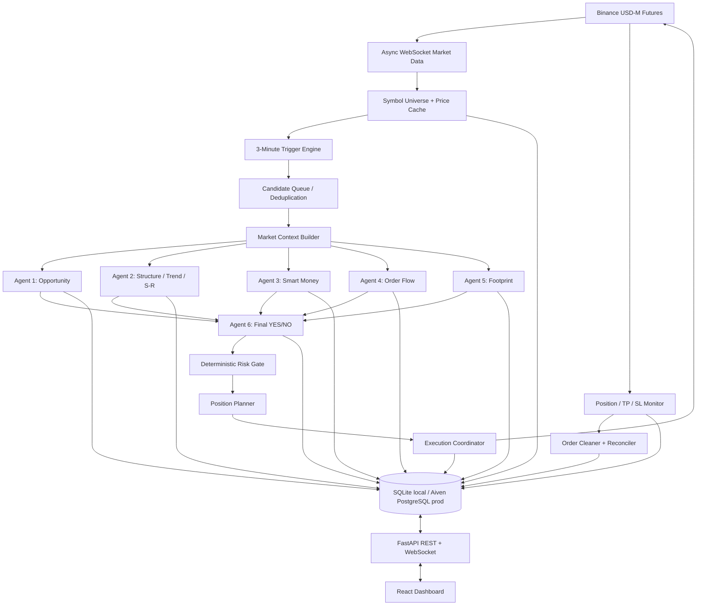

# Super Signal 🎯 — System Architecture

## 1. Architecture principles

1. **Exchange state is authoritative.** Local database state is a durable projection and audit trail, not the source of truth for balances, positions, fills, or open orders.
2. **Deterministic safety before AI.** AI can reject or recommend; it cannot override exchange constraints, risk checks, or safety interlocks.
3. **Fail closed.** Missing data, AI timeouts, malformed outputs, stale prices, or uncertain account state prevent new entries.
4. **Idempotent execution.** Every trade intent and exchange order has a stable identifier; ambiguous outcomes are reconciled before retry.
5. **Separate market data, decisions, and execution.** Components communicate through typed events and explicit state transitions.
6. **Portable persistence.** SQLAlchemy models and Alembic migrations support SQLite locally and PostgreSQL in production.

## 2. High-level component map



## 3. Runtime services

### 3.1 Market data service

Responsibilities:
- Load exchange metadata and eligible USDⓈ-M perpetual symbols.
- Subscribe to last-price/ticker streams for all eligible symbols using supported Binance stream topology.
- Maintain per-symbol timestamped price buffers sufficient for the rolling 180-second comparison.
- Optionally consume 1-minute kline, aggregate trade, depth, and other supported feeds for analysis.
- Detect stale streams, sequence/timestamp anomalies, and subscription gaps.
- Reconnect with exponential backoff and jitter; refresh listen/subscription state after reconnect.

Implementation notes:
- Use a dedicated asyncio task group and bounded queues.
- Do not launch one unbounded task per tick.
- Normalize symbols, timestamps, decimals, and event types at the adapter boundary.
- The scanner must not rely on REST polling for every symbol.
- REST is used for metadata, account/order operations, and reconciliation within rate limits.

### 3.2 Trigger engine

Input: normalized last-price events.  
Output: `SignalCandidate`.

Suggested event:

```json
{
  "event_id": "uuid",
  "symbol": "BTCUSDT",
  "direction": "LONG",
  "price_now": "65000.10",
  "price_reference": "64000.00",
  "change_pct": "1.562656",
  "window_seconds": 180,
  "exchange_event_time": "2026-01-01T00:00:00Z",
  "detected_at": "2026-01-01T00:00:00Z"
}
```

Use `Decimal` for financial values. A ring buffer or time-indexed deque stores recent samples. Trigger deduplication uses a unique key such as `(symbol, direction, cooldown_bucket)` and a durable candidate state.

### 3.3 Market context builder

Build one immutable snapshot per candidate:
- Symbol metadata and filters.
- Trigger values and timestamps.
- Current and historical prices.
- 1m/5m/15m candles as configured.
- Volume and volatility context.
- Order book/trade-flow data if available.
- Funding rate, open interest, and other fields only if supported and fresh.
- Data-quality flags, source timestamps, and missing-field list.

The snapshot must distinguish observed values from calculated indicators and unavailable fields. Agents must not be told that unavailable footprint or smart-money data exists.

### 3.4 AI orchestration service

- Integrate with ThreeRouter through a dedicated HTTP client.
- Keep provider URLs, model/agent identifiers, request schema, and response schema configurable; do not assume undocumented endpoint paths or model names.
- Agents 1–5 run concurrently using `asyncio.gather` with bounded concurrency and per-agent timeout.
- Each response is schema-validated and persisted.
- Agent 6 runs only after the five results are collected or a timeout policy marks missing results as unavailable.
- Any critical failure or insufficient data produces a fail-closed rejection.
- Store prompt version, model/agent identifier, latency, token/cost metadata if returned, response, and validation status. Redact credentials and sensitive account details.

### 3.5 Position planner and risk engine

The planner receives:
- Candidate and final AI decision.
- Actual exchange account mode and available balance/margin.
- Symbol tick/step/min-notional rules.
- Configured margin, leverage, TP/SL policy, fee assumptions, slippage assumptions, and global risk limits.

The risk engine independently:
1. Validates direction and stop placement.
2. Computes quantity using contract specifications and rounding.
3. Computes notional and initial-margin estimate.
4. Computes modeled loss to stop plus entry/exit fees and slippage.
5. Applies leverage-bracket and account-level margin checks.
6. Rejects if loss exceeds allocated margin or any global limit.
7. Produces a signed-off `RiskApproval` object with expiry and snapshot hash.

The AI response must never be used as the only sizing calculation.

### 3.6 Execution coordinator

- Serializes entry decisions per account/symbol where needed.
- Creates durable `TradeIntent` before network submission.
- Generates deterministic `newClientOrderId` values within exchange constraints.
- Submits market entry.
- Queries order state after timeouts/ambiguous responses before any retry.
- On fill, records actual quantity/average price and recalculates TP/SL.
- Places protective exits using current Binance-supported conditional order APIs.
- Verifies exchange acknowledgements and open-order/position state.
- Marks trade `PROTECTED` only after both required protection conditions are confirmed.

Never assume that a successful HTTP response means the position is protected. Verify exchange state.

### 3.7 Position monitor

- Reconcile each open position against exchange position state.
- Verify TP/SL order presence, quantity, side, trigger price, and reduce-only/close-position behavior.
- Detect partial fills, order cancellation, position-size changes, and manual intervention.
- If protection is absent, execute a bounded repair policy.
- If repair fails, invoke emergency close according to configured safety policy and alert the operator.
- Avoid duplicate close orders by using idempotent client IDs and rechecking state.

### 3.8 Cleaner

- Trigger only after exchange confirms position quantity is zero or closed.
- Cancel bot-owned residual orders for that trade/symbol.
- Confirm cancellation and no residual bot exposure.
- Do not cancel manual orders or unrelated strategies' orders.
- Record cleanup result and unresolved order IDs.

### 3.9 Reconciliation service

Run:
- At startup before engine activation.
- After every WebSocket/REST reconnect.
- Periodically while running.
- Before and after order placement/cancellation.
- During graceful shutdown.

Compare local trades/intents with exchange positions, open orders, fills, and balances. Unknown exchange positions must block new entries until classified or explicitly acknowledged.

## 4. Backend API

FastAPI exposes authenticated endpoints. Suggested route groups:

| Method | Route | Purpose |
|---|---|---|
| GET | `/api/health` | Liveness |
| GET | `/api/ready` | Dependencies and readiness |
| GET/PUT | `/api/config` | Non-secret settings; secrets masked |
| POST | `/api/credentials/test` | Validate credentials without storing raw response |
| POST | `/api/engine/start` | Run readiness checks, then start |
| POST | `/api/engine/stop` | Stop new entries; keep protection monitors active |
| POST | `/api/engine/emergency-stop` | Disable entries and invoke configured flatten/protection policy |
| GET | `/api/engine/status` | Runtime state |
| GET | `/api/market/symbols` | Scanned symbol universe |
| GET | `/api/signals` | Trigger candidates |
| GET | `/api/positions` | Exchange-reconciled positions |
| GET | `/api/trades` | Trade history |
| GET | `/api/logs` | Filtered logs |
| GET | `/api/metrics` | KPIs |
| WS | `/api/ws` | Authenticated live dashboard events |

All mutating routes require authentication, authorization, CSRF protection where cookie auth is used, validation, audit logging, and rate limiting.

## 5. React frontend

Suggested pages:
- Overview: account summary, engine state, risk status, KPI cards.
- Live Scanner: symbols, price movement, candidate queue, AI status.
- Positions: open positions and protection health.
- Trade History: filters, P&L, entry/exit and agent trace.
- Configuration: exchange, ThreeRouter, trigger and risk settings.
- System: health, connection status, logs, reconciliation warnings.

The browser receives only masked credential status, never secret values. Live data uses authenticated WebSocket with reconnect and snapshot resync.

## 6. Persistence architecture

### Local development
- SQLite file in application data directory, not source repository.
- SQLAlchemy 2.x async-compatible access pattern where appropriate.
- Alembic migrations.
- WAL mode and foreign keys enabled for SQLite.
- Single execution coordinator; do not assume SQLite is safe for multi-instance production workers.

### Production
- Aiven for PostgreSQL, TLS required and certificate verification enabled.
- `DATABASE_URL` injected as a secret.
- Alembic migrations run as a controlled deployment step.
- Connection pooling sized to Aiven plan and app worker count.
- Backups and restore procedure tested.
- Use PostgreSQL transaction locks/unique constraints for concurrency and idempotency.

Aiven provides managed database services and also documents Aiven Runtime for application deployment. If using Aiven Runtime, deploy the application from the repository using its supported application workflow; otherwise deploy the app to a separate VPS/container host and connect it to Aiven PostgreSQL. See [Aiven products](https://aiven.io/docs/products/overview), [Aiven PostgreSQL](https://aiven.io/docs/products/postgresql), and [Aiven Runtime app deployment](https://aiven.io/docs/products/runtime/deploy-apps).

## 7. Deployment topology

### Phase A — Windows PC
- Python virtual environment for FastAPI/worker.
- Node.js toolchain for React.
- SQLite database.
- `.env` for local development only, excluded from Git.
- Binance Testnet by default.
- Local TLS not required for loopback-only development; authentication still required.

### Phase B — Online production
- Containerized API/worker and React static frontend.
- PostgreSQL on Aiven with TLS.
- Secrets injected through runtime environment/secret manager.
- Persistent logs/metrics and alerting.
- Single active trading worker initially; dashboard/API can scale separately.
- Health checks and controlled restart policy.
- Verify exchange IP allowlist and network egress requirements.

Do not deploy the trading engine as multiple replicas until distributed leader election/locking and idempotent execution are implemented and tested.

## 8. Suggested repository layout

```text
super-signal/
├── backend/
│   ├── app/
│   │   ├── api/
│   │   ├── core/
│   │   ├── db/
│   │   ├── exchange/
│   │   ├── market_data/
│   │   ├── signals/
│   │   ├── agents/
│   │   ├── risk/
│   │   ├── execution/
│   │   ├── monitoring/
│   │   ├── services/
│   │   └── main.py
│   ├── migrations/
│   └── tests/
├── frontend/
│   ├── src/
│   └── tests/
├── docs/
├── scripts/
├── deploy/
├── .env.example
├── .gitignore
├── docker-compose.yml
├── pyproject.toml
└── README.md
```

## 9. Failure boundaries

| Failure | Required behavior |
|---|---|
| Market WebSocket down/stale | Block new signals; reconnect; reconcile |
| AI provider unavailable | Reject candidate; no trade |
| Agent output malformed | Reject candidate |
| Database unavailable | Block new entries; preserve protective monitoring if possible |
| Binance order timeout | Query by client ID/order state before retry |
| TP/SL placement fails | Repair; if unresolved, emergency close |
| App restart | Reconcile before accepting signals |
| Aiven DB unreachable | Do not open new positions; alert and retry connection |
| Dashboard disconnected | Trading policy continues, but backend safety controls remain active |
| Shutdown request | Stop entries; keep protection/reconciliation until safe handoff |

## 10. Observability

Every event carries `correlation_id`, `candidate_id`, `trade_id`, `symbol`, and timestamp where applicable. Metrics include WebSocket lag, symbol coverage, trigger count, AI latency/error rate, order latency, unprotected-position duration, reconciliation drift, database pool saturation, and realized/unrealized P&L.
